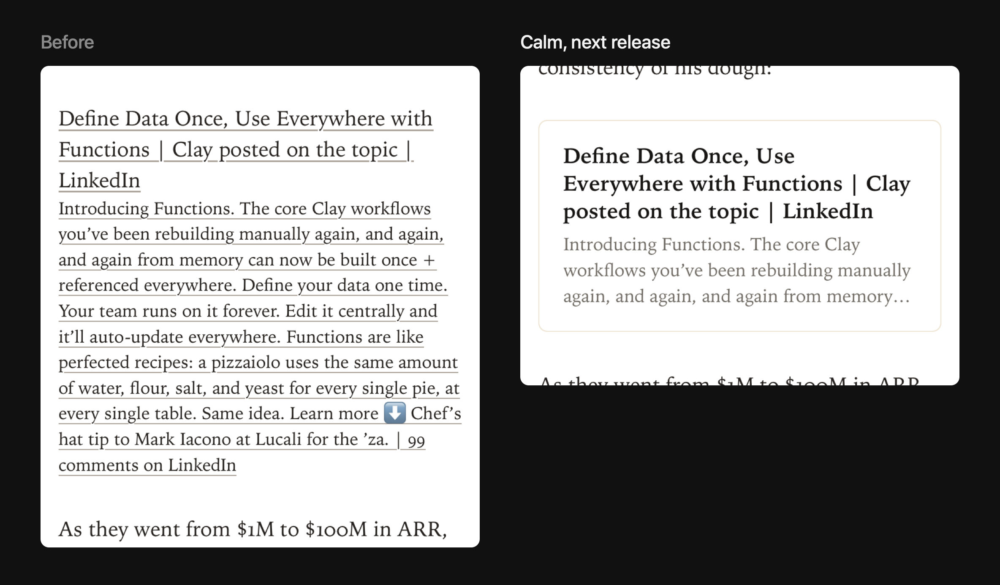
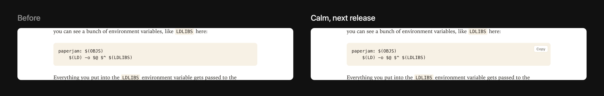

# Before and after

Made by `node scripts/before-after.mjs` against `origin/main`. At release, rename the folder's files to `<version>-<slug>.jpg` and move them up into `assets/releases/`.

### footnote-popover

### untitled-post

### gallery-row

### link-card

### podcast-caption

### code-copy

