# Before and after

Made by `node scripts/before-after.mjs` against `origin/main`; the 1.5 parity images (macrumors-deal-gaps, duplicate-cover-sized, code-language, feed-*, pullquote-aside) against `605b5b5`, the commit before that work. At release, rename the folder's files to `<version>-<slug>.jpg` and move them up into `assets/releases/`.

### footnote-popover

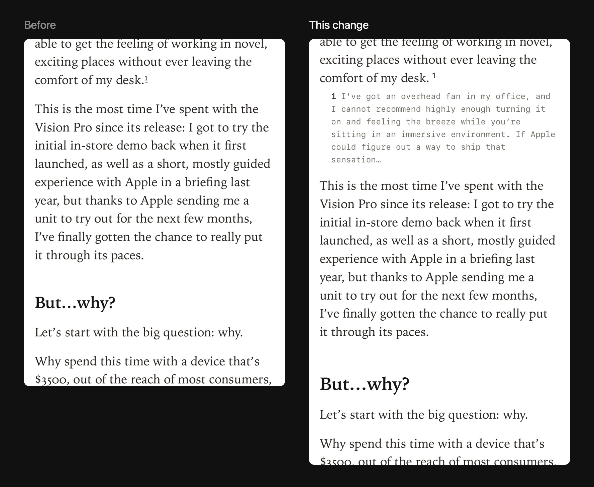

### untitled-post

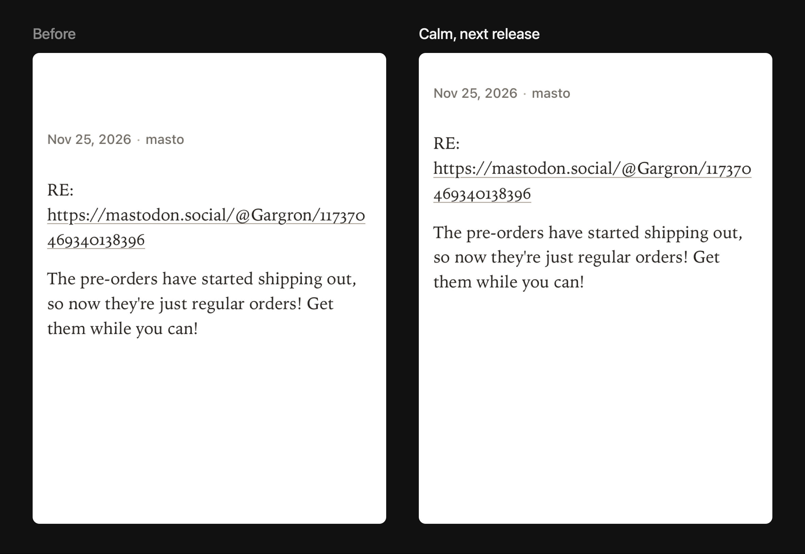

### gallery-row

### link-card

### podcast-caption

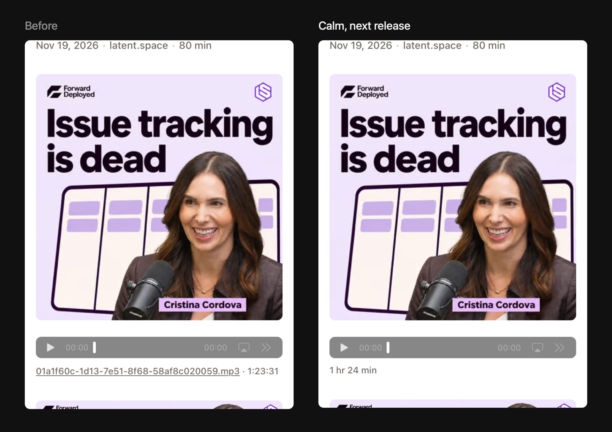

### code-copy

### Gallery row, in the NetNewsWire app (Mac)

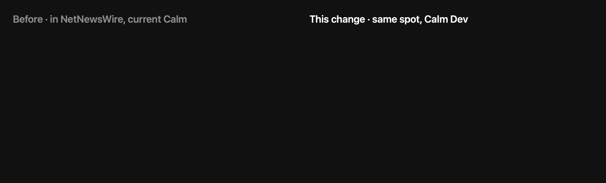

### Copy button on one-line commands, in the NetNewsWire app (Mac)

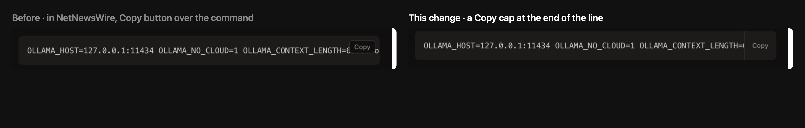

### Link card, in the NetNewsWire app (Mac)

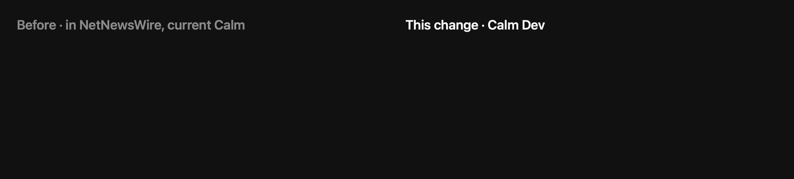

### Cover shown once, in the NetNewsWire app (Mac)

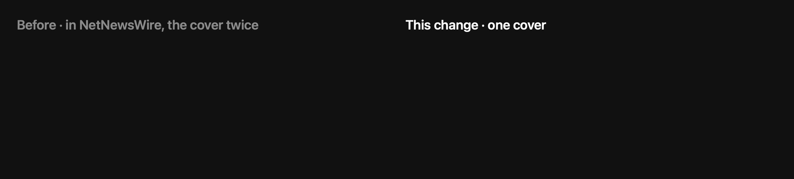

### X posts follow dark mode, in the NetNewsWire app (Mac)

### Podcast caption, in the NetNewsWire app (Mac)

### Footnotes, in the NetNewsWire app (Mac)

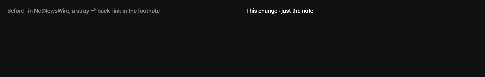

### Untitled posts, in the NetNewsWire app (Mac)

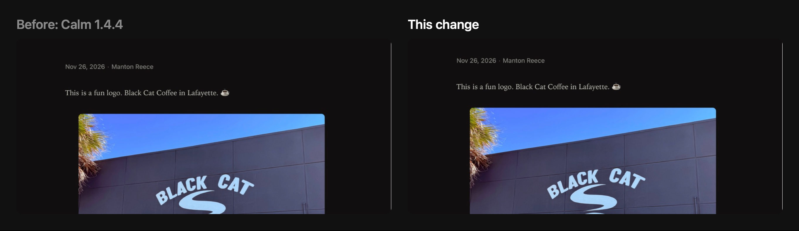

### duplicate-cover-sized

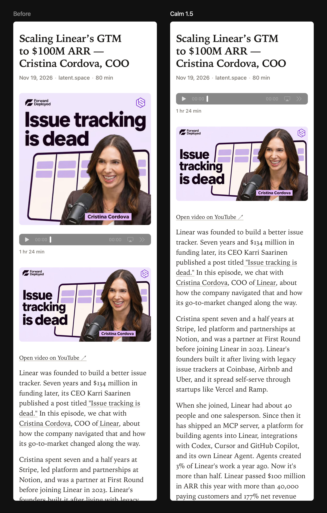

### code-language

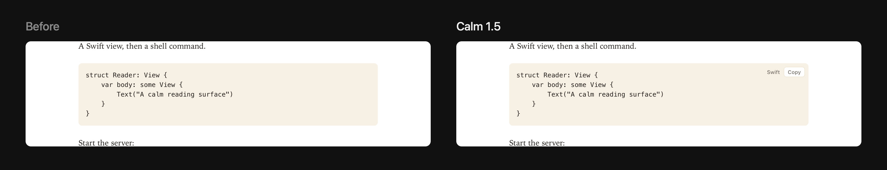

### code-language-dark

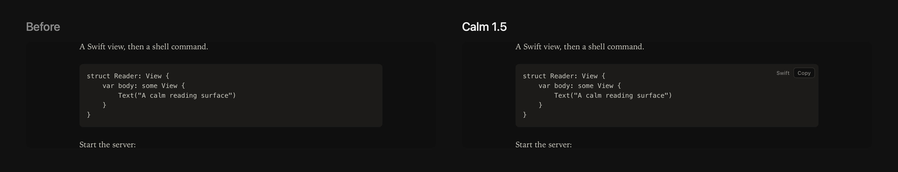

### macrumors-deal-gaps

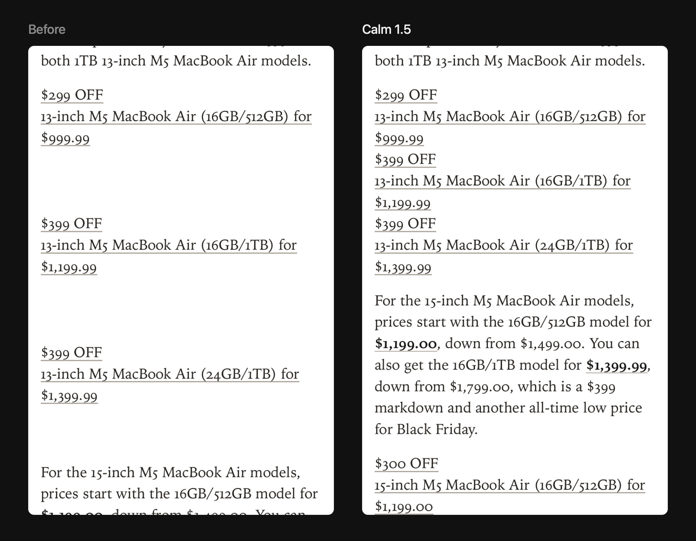

### feed-credit

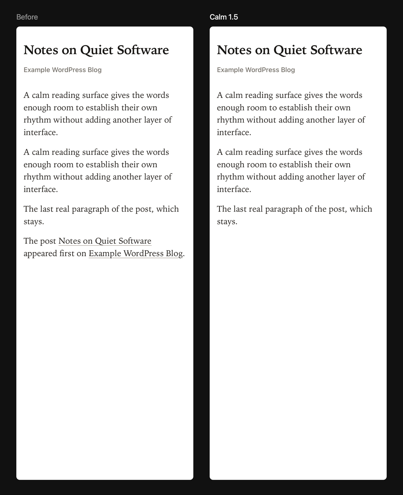

### feed-footnotes

### feed-cards

### feed-cards-dark

### pullquote-aside

