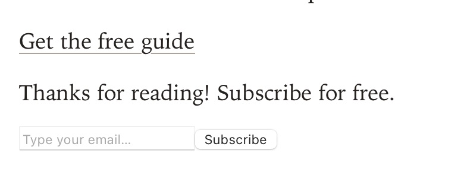
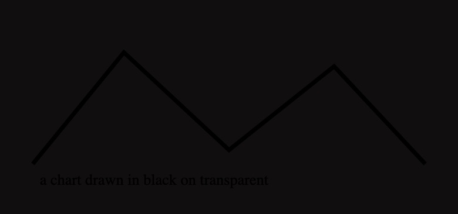
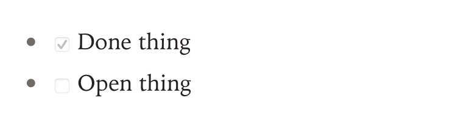
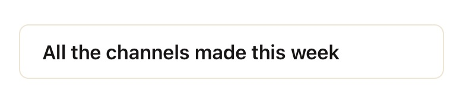
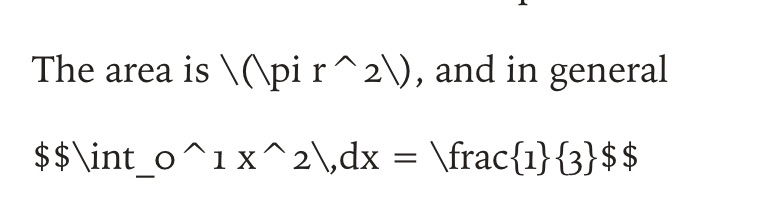

# Elevation candidates

Markup Calm still shows at the browser's default, or below the care it gives the rest of the page, ranked by how much reading it improves for its cost. Sources: 145 real feed items in the gitignored corpus (126 of them from 23 platforms in `.corpus/platforms/`, see `docs/compatibility.md`) and the theme comparison of 2026-11-26 (`.parity/REPORT.md`, local). None of these is built yet.

Every candidate has to pass the rules in `AGENTS.md`: done in CSS or the first script pass, no change after first paint, no false positives, no rise in the performance budgets. "Corpus" counts items that contain the markup.

The images in `docs/elevation/` show the current look on synthetic markup at 390 wide.

## Ranked

### 1. Substack buttons, subscribe widgets and newsletter forms

- **Now:** Substack's call-to-action button is a plain underlined link. Its subscribe widget and Mailchimp sign-up forms (MacRumors) show as a bare text box and a small system button that can't do anything useful inside a reader. 
- **Calm standard:** the button as one quiet bordered pill, like Calm's link cards; in-article sign-up forms hidden, since the reader already subscribes by feed.
- **Before first paint:** yes, CSS only (`.button-wrapper a.button`, `.subscription-widget-wrap`, `form:has(input[type=email])`).
- **Platforms:** Substack, Mailchimp embeds on WordPress (other newsletter platforms unchecked). Corpus: 2 Substack button items, 2 MacRumors forms.
- **Cost:** nothing measurable; one `:has` rule scoped to forms.
- **Recommendation:** do. Negative case: a form that isn't a sign-up (a search box in a tutorial) stays.

### 2. Transparent line art in dark mode

- **Now:** a chart or diagram drawn in black on a transparent PNG or SVG disappears on Calm's dark page. No other theme handles it either. 
- **Calm standard:** a soft paper-toned backing with Calm's radius behind PNG, GIF and SVG pictures in dark mode, so line art reads; photos (JPEG, WebP) are opaque and unchanged.
- **Before first paint:** yes, CSS only, by file type in `src`. Calm can't know an image is transparent without waiting for it to load, so it goes by type.
- **Platforms:** all. Corpus: PNG pictures in 68 items across 26 sources.
- **Cost:** none in script. The risk is visual: the backing shows as a light box while a PNG loads, and a logo made for dark pages gets a light backing it doesn't need.
- **Recommendation:** do, with a muted backing (not white) and a before/after check on real dark-mode feeds with screenshots and charts.

### 3. Task lists

- **Now:** GitHub-style task lists show a bullet and a tiny grey checkbox side by side. 
- **Calm standard:** no bullet; a checkbox at text size in Calm's accent colour, aligned with the first line.
- **Before first paint:** yes, CSS (`li:has(> input[type=checkbox])`, `accent-color`).
- **Platforms:** GitHub, Jekyll, Hugo, Ghost Markdown. Corpus: 1 item.
- **Cost:** none.
- **Recommendation:** do; small and safe.

### 4. Captions sent as plain blocks

- **Now:** captions that aren't `<figcaption>` read as body text: Jekyll themes' `.imgcap`/`.thecap` (Karpathy), WordPress classic `.wp-caption-text`, Blogger's `.tr-caption` cells.
- **Calm standard:** the same small, muted, centred caption Calm gives `<figcaption>`.
- **Before first paint:** yes, CSS by class.
- **Platforms:** Jekyll, WordPress (classic editor), Blogger. Corpus: 7 items across 3 platforms.
- **Cost:** none.
- **Recommendation:** do, checking each class only matches captions on the corpus first.

### 5. Disclosure marker on details/summary

- **Now:** Calm already draws `
` as a bordered box, but the closed state shows no marker, so it isn't clear it opens. 
- **Calm standard:** a small chevron before the summary that turns when open, in the muted colour.
- **Before first paint:** yes, CSS (`summary::before`, `details[open]`); motion respects reduced motion.
- **Platforms:** WordPress details block, Pandoc, GitHub. Corpus: 3 items, 3 platforms.
- **Cost:** none.
- **Recommendation:** do.

### 6. Gist embeds

- **Now:** a GitHub Gist embed is a `<script>` that a reader never runs, so the code silently disappears and the text around it refers to nothing.
- **Calm standard:** a link card in Calm's link-card style ("Code on GitHub Gist" and the gist's name) where the script was.
- **Before first paint:** yes, built in the existing first pass from the script's `src`; nothing waits on the network.
- **Platforms:** Jekyll, WordPress, Medium (older posts). Corpus: 1 item.
- **Cost:** one `querySelectorAll("script[src*='gist.github.com']")`; well under 1 ms.
- **Recommendation:** do, low priority (rare in the corpus).

### 7. Audio players in the article

- **Now:** a bare `<audio>` (Ghost audio card, Jekyll) gets WebKit's grey control bar with no title, unlike NetNewsWire 7.3's podcast player, which Calm captions.
- **Calm standard:** the same width, radius and spacing as Calm's podcast player.
- **Before first paint:** partly: CSS can size and place the control but WebKit's own controls can't be restyled much.
- **Platforms:** Ghost, Jekyll. Corpus: 3 items.
- **Cost:** none.
- **Recommendation:** do the sizing only if it's part of other audio work; skip otherwise.

## Skip

- **MathJax written as raw TeX** (`\( … \)`, `$$ … $$`). Shows as source text. Rendering needs a math library that changes the text after load, a visible swap.  KaTeX, which arrives pre-rendered, is handled in Calm 1.5.
- **Broken images.** WebKit shows its "?" box. Calm can't know an image failed until after it tries to load, and replacing it then is a swap after load.
- **Image stepping (a viewer that pages through pictures, as Ringo has).** NetNewsWire owns taps on images and has its own viewer on iPhone; a theme viewer would add chrome and fight the app.
- **Medium figures.** Medium sends standard `<figure>` and `<figcaption>`; they already get Calm's figure style.
- **kbd, definition lists, figcaptions, body h1s.** Already at the Calm standard (styled keys, indented definitions, muted captions, h1 scaled below the title).
- **Jekyll/Rouge code label.** Done in Calm 1.5 (with Pandoc, Quarto and bare-class blocks).
