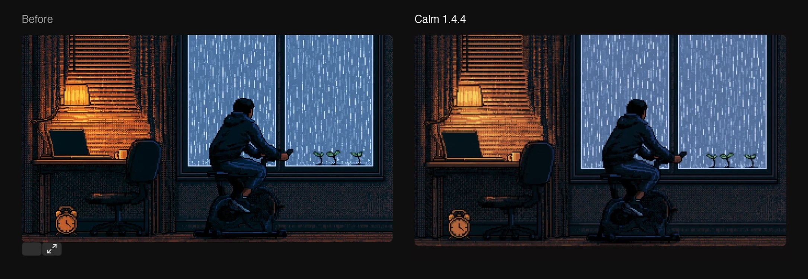

# Calm 1.4.4

Calm 1.4.4 tidies what feeds leave behind, so articles read the same in
Calm whatever published them.

## Fixes

- Empty paragraphs and blank separators no longer add gaps between
  paragraphs. Blogger and many editors leave these in their feeds.
- WordPress image captions with a fixed width no longer push the image off
  the edge of an iPhone screen. Every block now stays inside the column.
- Substack's restack and expand buttons under images are gone. They only
  work on Substack.

## Staying up to date

- Subscribe to Calm's release feed in NetNewsWire to hear about new
  versions: https://github.com/raisulchowdhury/calm-nnwtheme/releases.atom
