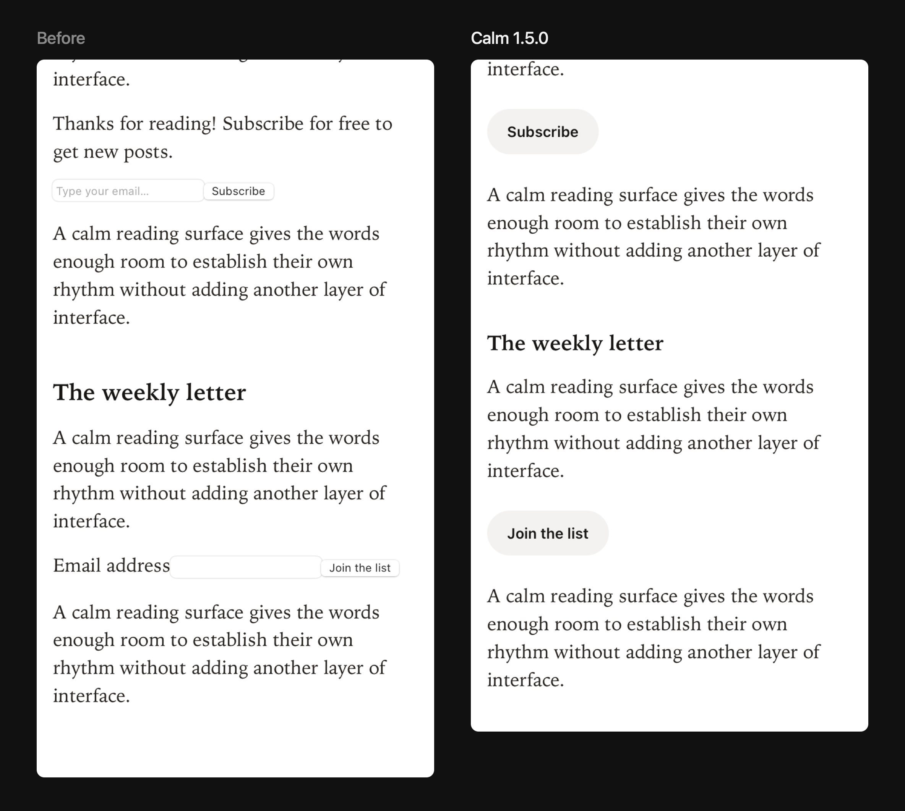
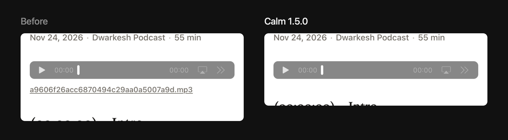
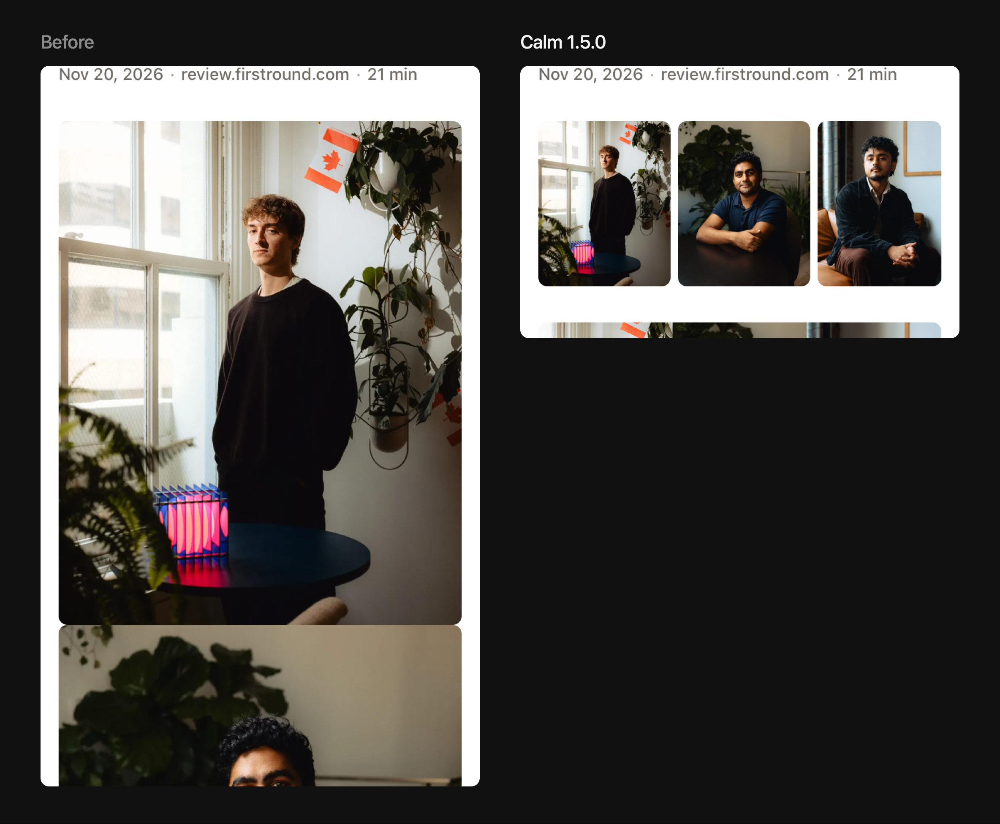
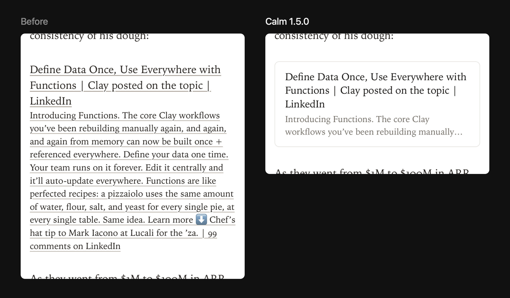
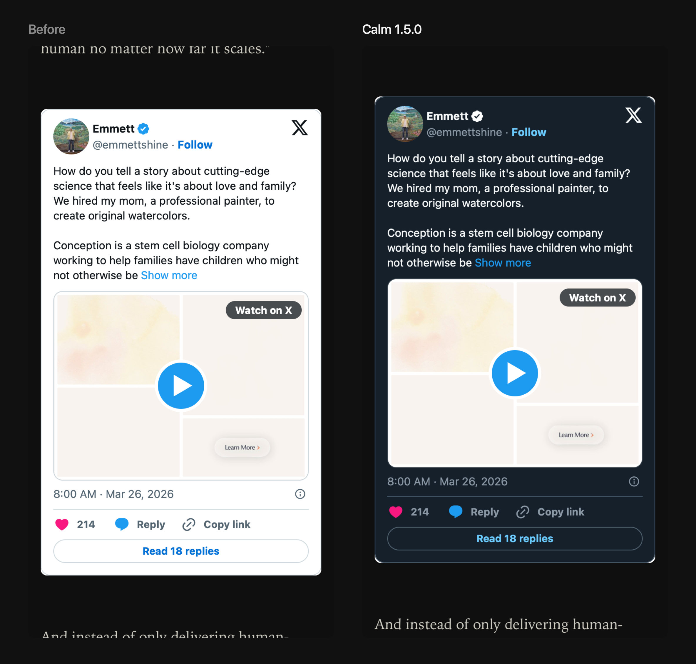
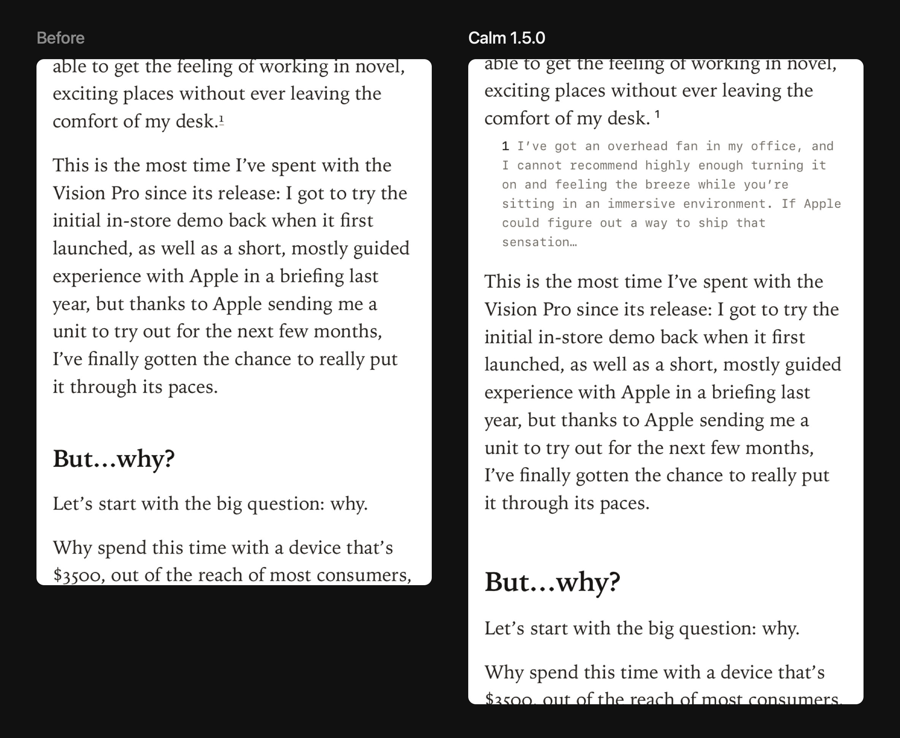
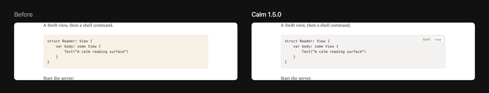

# Calm 1.5.0

Calm 1.5 is its biggest update. It fixes what publishers put in their
feeds that came out wrong in a reader: sign-up forms, podcast file names,
photo galleries, link cards, X posts in dark mode and footnotes. Calm now
handles what WordPress, Ghost, Substack, Medium, Jekyll and other platforms
send, so an article reads the same whatever published it.

Most changes have a before and after image in
[assets/releases](https://github.com/raisulchowdhury/calm-nnwtheme/tree/main/assets/releases).

## Highlights

**Sign-up forms become one quiet button.** An email sign-up form can't send
from a feed reader, so Calm replaces it with one button to the publisher's
sign-up page. Links a publisher styled as buttons show as the same soft pill.

**No file names under podcasts.** Under a podcast player, Calm drops the
file name or size in bytes the feed sends, and shows the episode's length
when the feed gives it.

**Photo galleries stay in a row.** A Ghost gallery shows its photos side by
side at one height, instead of each one stacked full width.

**Link cards are one quiet card.** A linked post from Substack, Ghost or
WordPress shows as one card instead of loose text and counts.

**X posts follow dark mode.** When X's own script draws a post, it is dark
on a dark page, and the page shows outside the rounded corners of X and
Bluesky posts, where white tips used to show.

**Footnotes open in the text.** A footnote is a plain small number. Tap it
and the note opens under that line and moves the text below down. Tap the
number again, or press Escape on a Mac, to close it. It works with footnotes
from Substack, Ghost, WordPress, Jekyll, Hugo, Pandoc, GitHub Markdown and
Daring Fireball, and with feeds read through FreshRSS. On Six Colors, tapping
a footnote used to leave the app.

## More changes

- A cover picture that repeats at the top of a post shows once, even when
  the two are different sizes of the same file.
- Captions sent as plain text under a picture look like captions.
- The "appeared first on" line WordPress adds, and Medium's "originally
  published" line, are gone. Posts end on their last paragraph.
- Posts with no title, from Mastodon, Bluesky or micro.blog, no longer leave
  an empty line above the date.
- A video with no size set stays in its box instead of covering the line
  below it. In dark mode the box is black from the start, with no white
  flash.
- Ghost toggles read as a question and its answer, and callouts get a tint.

## Code and pictures on the Mac

- Hover over a code block for a quiet Copy button, with the block's language
  beside it. On a one-line command they sit at the end of the line, clear of
  the command.
- Code with line numbers, from Jekyll, is one block with quiet
  numbers. This one is on iPhone too.
- Click a large picture to see it bigger. Escape, Space or another click
  closes it.

## Reading style

These weren't broken before. They read more clearly now.

- Headings step down clearly: a larger second-level heading over a smaller
  third-level one, so a section and a subsection don't look alike.
- Block quotes are upright in the text colour, set off by their rule,
  instead of grey italics.
- Bold words in a quote or caption keep that block's colour.
- On the Mac, at larger text sizes the gap between paragraphs grows with the text. The
  default size looks the same as before.
- In light mode, code blocks, buttons and thin rules are a quiet grey
  instead of cream.
- With Increase Contrast on, grey text and thin rules are darker in light
  mode and lighter in dark mode.
- Japanese, Chinese, Korean, Arabic and Hebrew articles get a serif and line
  rules that fit the script.

## Smaller changes

- MacRumors' deal buttons sit together, and Instagram's empty rows are gone.
- Pull quotes sit between two thin rules and asides sit in a tinted box.
- Task lists get a checkbox in place of the bullet.
- Math written with KaTeX no longer appears twice.
- Mastodon's custom emoji stay in the sentence at text size instead of
  dropping onto a line of their own.
- Pictures set beside the text take at most half the column, and stack on
  iPhone.
- Blank gaps from stray line breaks are closed.

## Known limits

- Black line drawings on a see-through background can still vanish in dark
  mode.
- X posts embedded as a plain frame stay white in dark mode. Making them
  dark needed a reload, and Calm doesn't change an article after it shows.
- X posts embedded as a plain frame are cut to a video-shaped box. Growing
  them to their real height would move the text after the article shows.
- Hugo's and Pygments' line-numbered code keeps two boxes and gets no Copy
  button. Select the code to copy it.

## Updating

If you have Calm 1.4.4, long articles will end with one faint line and an
Update link for the next two weeks. On anything older, open
[raisul.xyz/calm](https://raisul.xyz/calm#get) on the device, tap **Install
in NetNewsWire** and choose Overwrite.

Theme version 16.
