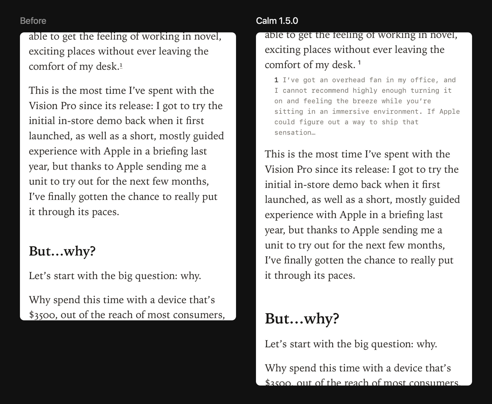
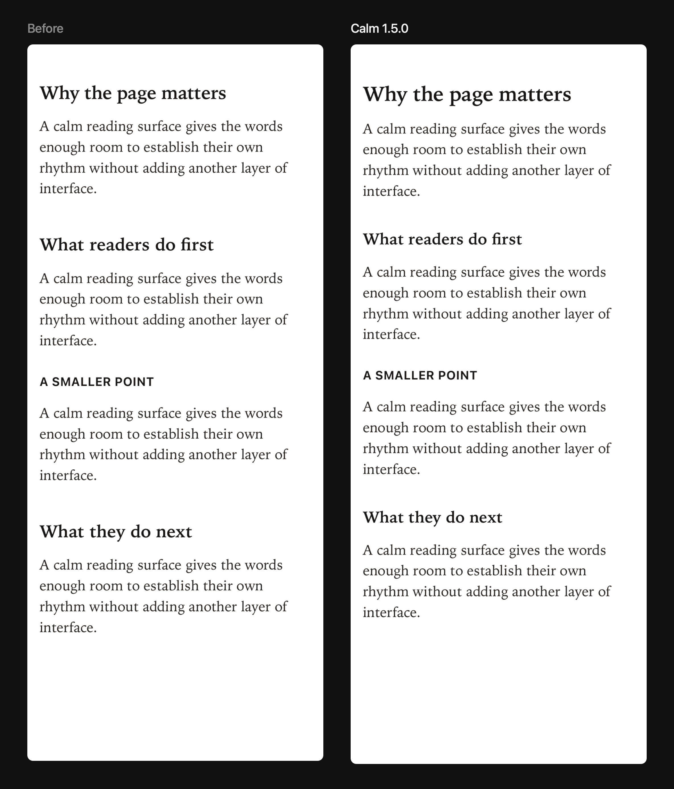
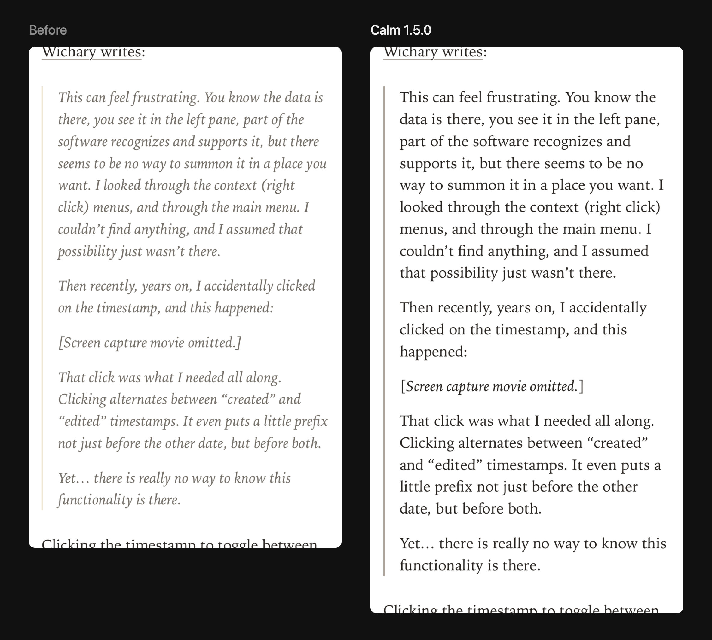
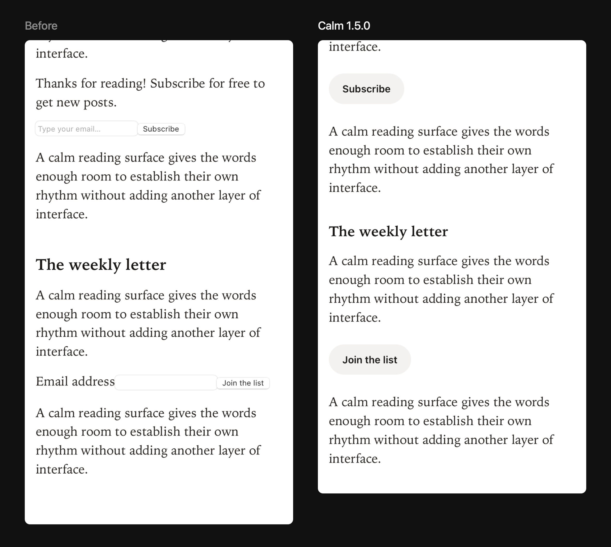
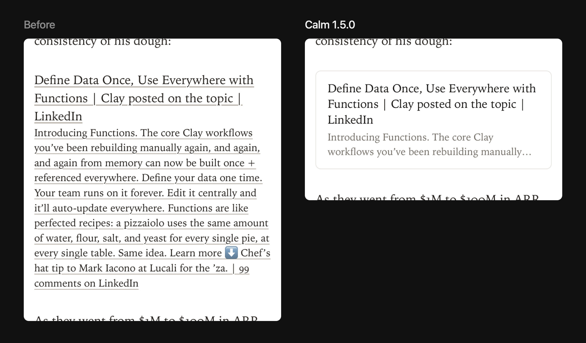
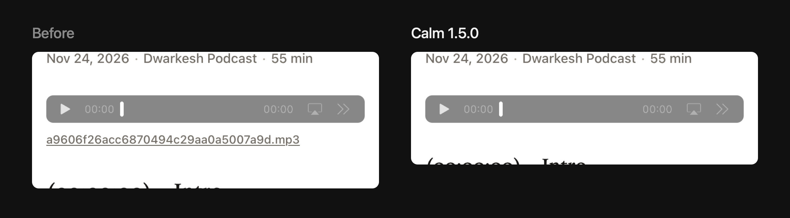
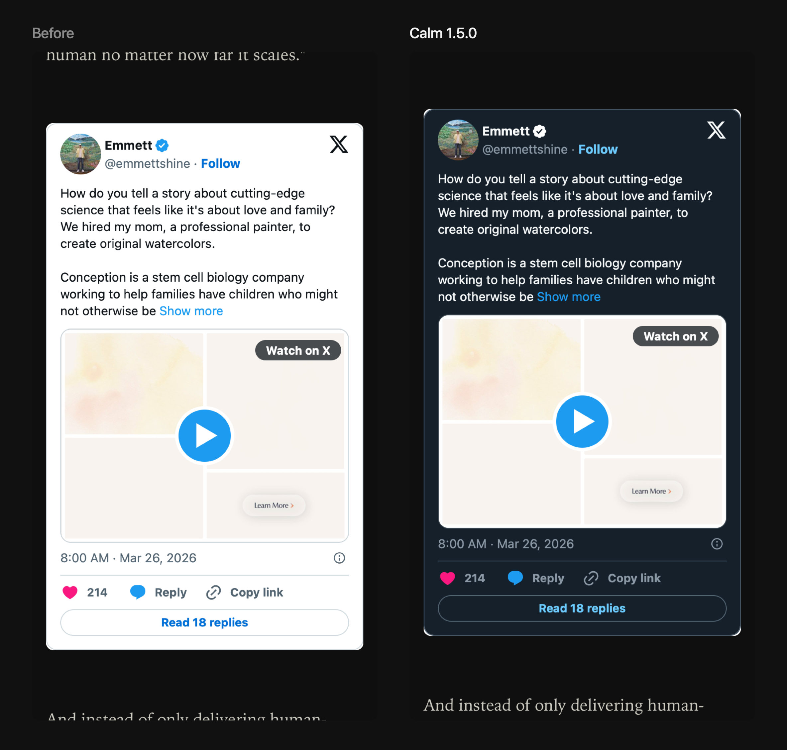
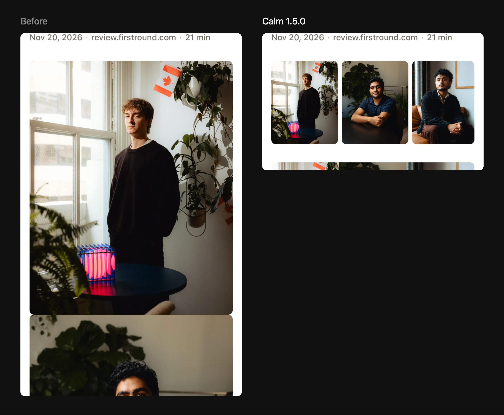
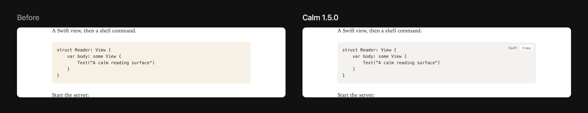

# Calm 1.5.0

Calm 1.5 is its biggest update. Footnotes open in the text, headings and
quotes read more clearly, and sign-up forms and linked posts get out of the
way. Below that are the smaller changes, biggest first: Calm now handles
what WordPress, Ghost, Substack, Medium, Jekyll and other platforms put in
their feeds, so an article reads the same whatever published it.

Every change has a before and after image in
[assets/releases](https://github.com/raisulchowdhury/calm-nnwtheme/tree/main/assets/releases).

## Highlights

**Footnotes open in the text.** A footnote is a plain small number. Tap it
and the note opens under that line and moves the text below down. Tap the
number again, or press Escape on a Mac, to close it. It works with footnotes
from Substack, Ghost, WordPress, Jekyll, Hugo, Pandoc, GitHub Markdown and
Daring Fireball, and with feeds read through FreshRSS. On Six Colors, tapping
a footnote used to leave the app.

**Headings step down clearly.** A larger second-level heading sits over a
smaller third-level one, so you can tell a section from a subsection.

**Quotes are upright.** Block quotes are in the text colour, set off by
their rule, instead of grey italics.

**Sign-up forms become one quiet button.** An email sign-up form can't send
from a feed reader, so Calm replaces it with one button to the publisher's
sign-up page. Links a publisher styled as buttons show as the same soft pill.

**Link cards are one quiet card.** A linked post from Substack, Ghost or
WordPress shows as one card instead of loose text, buttons and counts.

## Everyday reading

- The "appeared first on" line WordPress adds, and Medium's "originally
  published" line, are gone. Posts end on their last paragraph.
- Posts with no title, from Mastodon, Bluesky or micro.blog, no longer leave
  an empty line above the date.
- Podcast captions show the episode's length, not a file name.
- A cover picture that repeats at the top of a post shows once.
- Bold words in a quote or caption keep that block's colour.
- Captions sent as plain text under a picture look like captions.
- At larger text sizes the gap between paragraphs grows with the text. The
  default size looks the same as before.
- In light mode, code blocks, buttons and thin rules are a quiet grey
  instead of cream.
- With Increase Contrast on, grey text and thin rules are darker in light
  mode and lighter in dark mode.
- Japanese, Chinese, Korean, Arabic and Hebrew articles get a serif and line
  rules that fit the script.

## Dark mode, video and embeds

- X posts follow dark mode when X's own script draws them.
- In dark mode the page shows outside the rounded corners of an X or Bluesky
  post, where white tips used to show.
- A video with no size set stays in its box instead of covering the line
  below it. In dark mode the box is black from the start, with no white
  flash.
- Photo galleries stay a row of pictures instead of stacking full width.
- WordPress and Ghost toggles open, and callouts get a tint.
- A Ghost video shows its thumbnail instead of an empty box.
- X, Bluesky and Mastodon posts take their real height, not a wide video
  box.

## Code and pictures on the Mac

- Hover over a code block for a quiet Copy button, with the block's language
  beside it. On a one-line command they sit at the end of the line, clear of
  the command.
- Code with line numbers, from Jekyll and Pygments, is one block with quiet
  numbers. This one is on iPhone too.
- Click a large picture to see it bigger. Escape, Space or another click
  closes it.

## Smaller fixes

- Pull quotes sit between two thin rules and asides sit in a tinted box.
- Task lists get a checkbox in place of the bullet.
- Math written with KaTeX no longer appears twice.
- Emoji and small icons in a sentence stay the size of the text.
- Pictures set beside the text take at most half the column, and stack on
  iPhone.
- Blank gaps from stray line breaks, Instagram's empty rows and MacRumors'
  deal buttons are closed.

## Known limits

- Black line drawings on a see-through background can still vanish in dark
  mode.
- X posts embedded as a plain frame stay white in dark mode. Making them
  dark needed a reload, and Calm doesn't change an article after it shows.
- Hugo's line-numbered code gets no Copy button. Select the code to copy it.

## Updating

If you have Calm 1.4.4, long articles will end with one faint line and an
Update link for the next two weeks. On anything older, open
[raisul.xyz/calm](https://raisul.xyz/calm#get) on the device, tap **Install
in NetNewsWire** and choose Overwrite.

Theme version 16.
